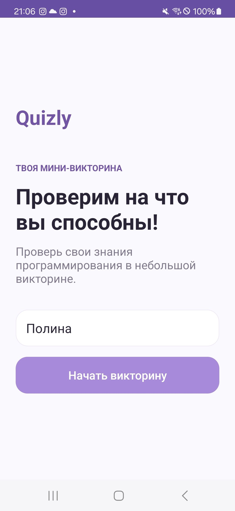
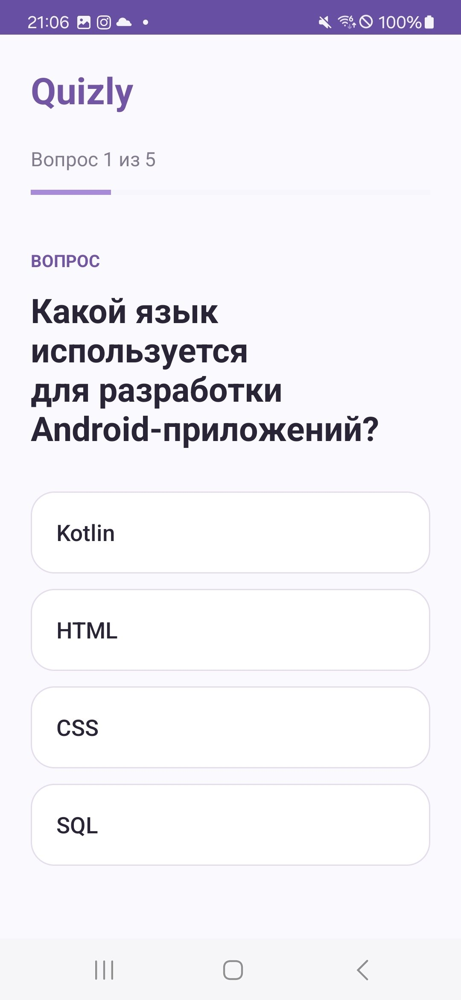
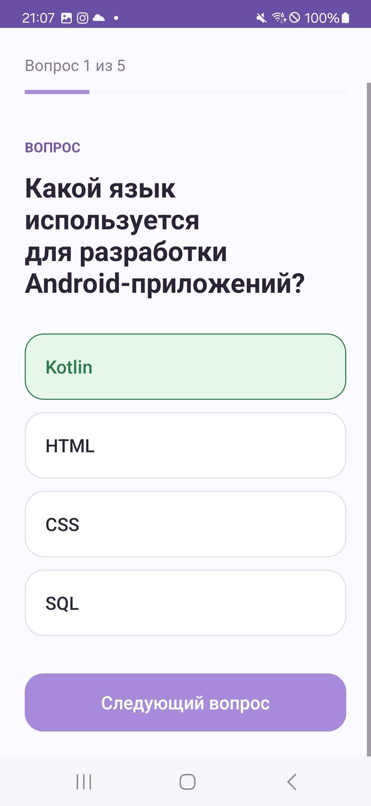
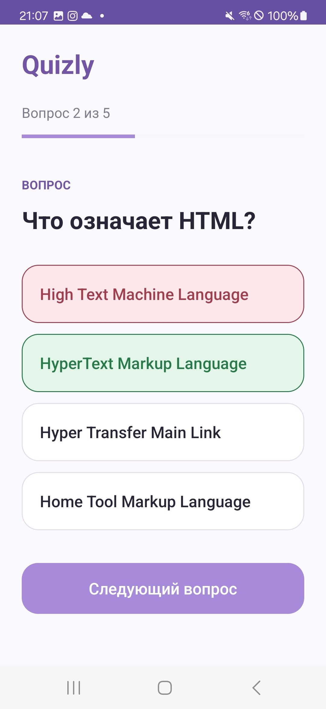
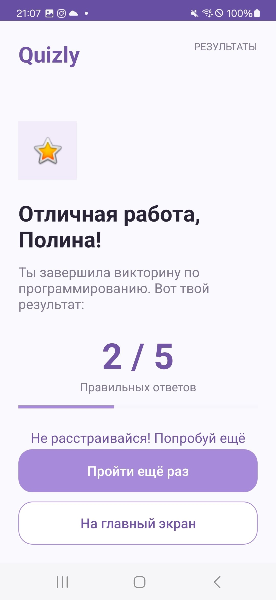

# Quizly

**Quizly** — мобильное Android-приложение для проверки знаний в области программирования, разработанное на языке Kotlin.

Приложение представляет собой интерактивную викторину из пяти вопросов с четырьмя вариантами ответа. Пользователь вводит своё имя, проходит тестирование и получает итоговый результат.

**Технологии:**

Android SDK, Kotlin, XML Layouts.

**Окружение:**  

Минимальная версия SDK - 26  
Версия SDK ориентир - 37  
Версия SDK для комиляции - 37

### Скриншоты приложения

Ниже представлены основные экраны и элементы интерфейса приложения **Quizly**.

